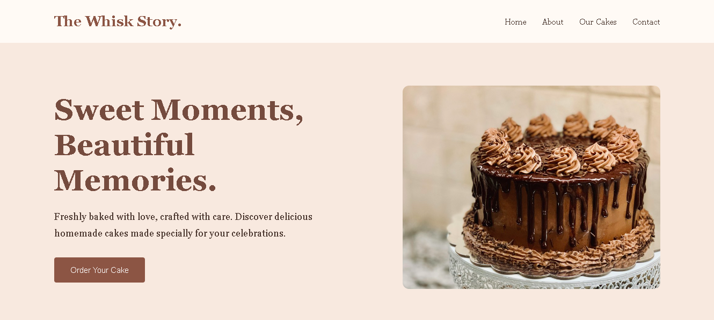

# 🍰 The Whisk Story

A bakery website built using HTML, CSS and JavaScript as a frontend development project.

## 🌐 Live Demo

[Visit The Whisk Story](https://wondrous-horse-e36410.netlify.app/)

## 📸 Website Preview

## 🛠️ Technologies Used

- HTML5
- CSS3
- JavaScript

## 📂 Project Files

- `index.html` — Main webpage
- `style.css` — Website styling
- `script.js` — JavaScript functionality
- `whisk-story-home.png` — Website preview

## 🎯 Purpose

Created to practise frontend development and improve website-building skills.

---

**Developed by Pranjal Shikha**
